# Architecture

> How every component fits together — from a single chat REPL to a 14-tool multi-agent system with workspace isolation.

## Overall Architecture

The system is organized in six horizontal layers, each building on the ones beneath it — though the multi-agent and isolation layers reuse the core agent loop as their primitive (a teammate is just another `agent_loop`). The loop at the center orchestrates everything — it calls the provider and dispatches tools — and its core while-loop *pattern* is unchanged from Phase 2 through Phase 11; later phases only add hooks around it (`quiet`, `background_manager`). The team and isolation layers add no new loop hooks at all — teammates run their own `agent_loop` on threads, and isolation is just a tool that shells out to `git worktree`.

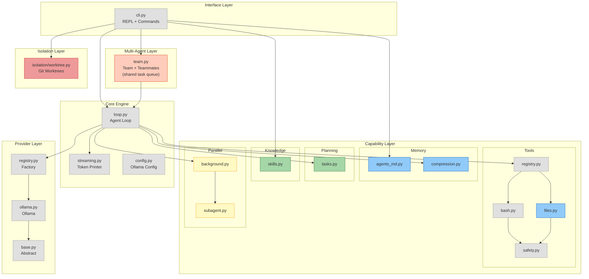

**Legend:** Gray = Phase 1-2 | Blue = Phase 3-4 | Green = Phase 5-6 | Yellow = Phase 7-8 | Orange = Phase 9-10 | Red = Phase 11

---

## Agent Loop: Control Flow

The core `agent_loop()` function drives the entire system. This sequence shows one complete turn — from user input to final response. The while-loop continues as long as the LLM returns tool calls.

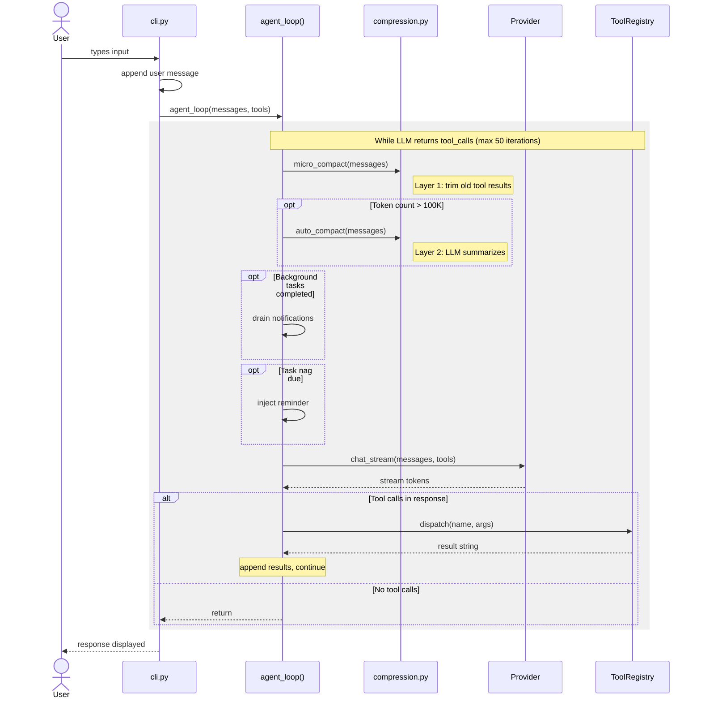

**Key insight:** This loop is written once in Phase 2 and never modified. Phases 4-11 add hooks *around* it (compression, nag, background notifications) but the core pattern — call LLM, dispatch tools, loop — is immutable. Teammates (Phase 9-10) and isolation (Phase 11) don't touch it at all — each teammate simply runs its own copy of this same loop.

---

## Phase Progression

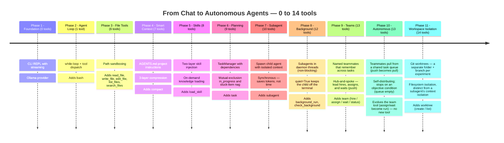

---

## Phase Details

### Phase 1: Foundation (0 tools)

The starting point: a streaming chat REPL connected to a local Ollama model. No tools — the agent can only talk.

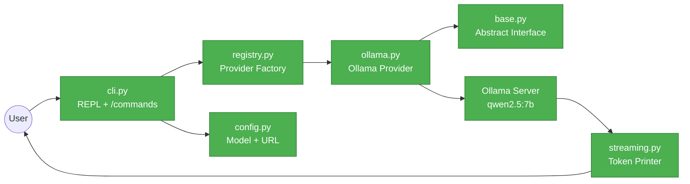

### Phase 2: Agent Loop (1 tool)

The heart of the system: a while-loop that calls the LLM, executes tool calls, and loops until the model is done.

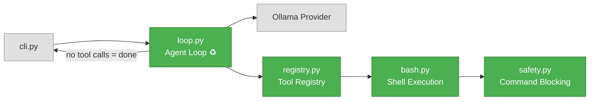

### Phase 3: File Tools (6 tools)

Five file operations with path sandboxing. The agent can now read, write, and edit files safely.

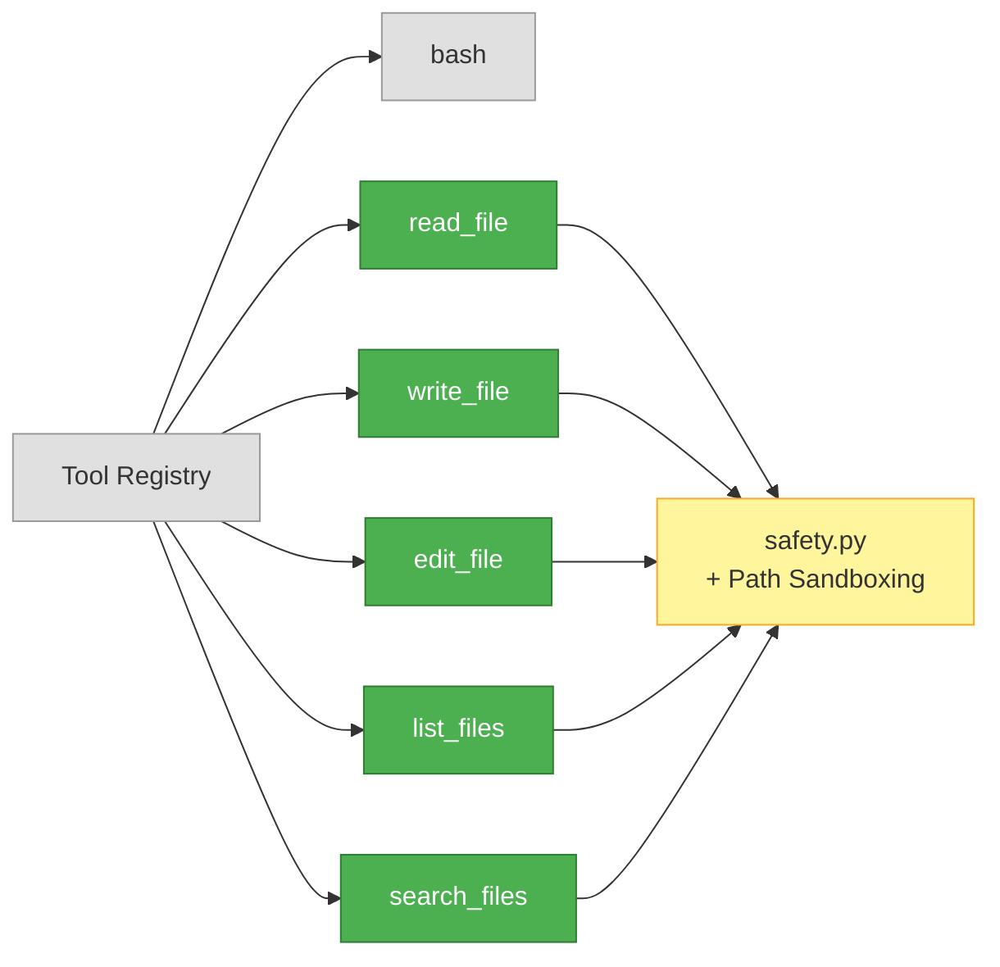

### Phase 4: Smart Context (7 tools)

Project instructions via AGENTS.md and three-layer compression to keep context manageable.

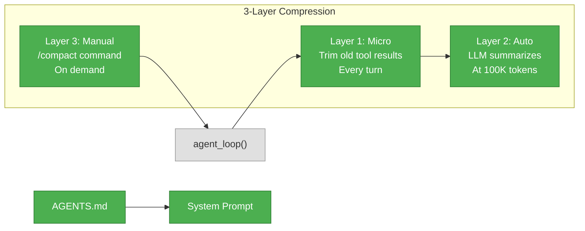

### Phase 5: Skills (8 tools)

Two-layer knowledge injection: lightweight summaries in the system prompt, full skill bodies loaded on demand.

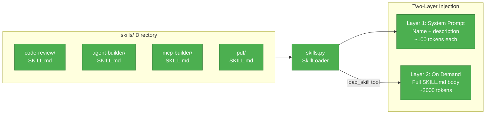

### Phase 6: Planning (9 tools)

A single TaskManager for structured work: dependency graph, mutual-exclusion `in_progress`, and a stuck-item reminder. One `task` tool with action dispatch covers create / update / list / get / delete.

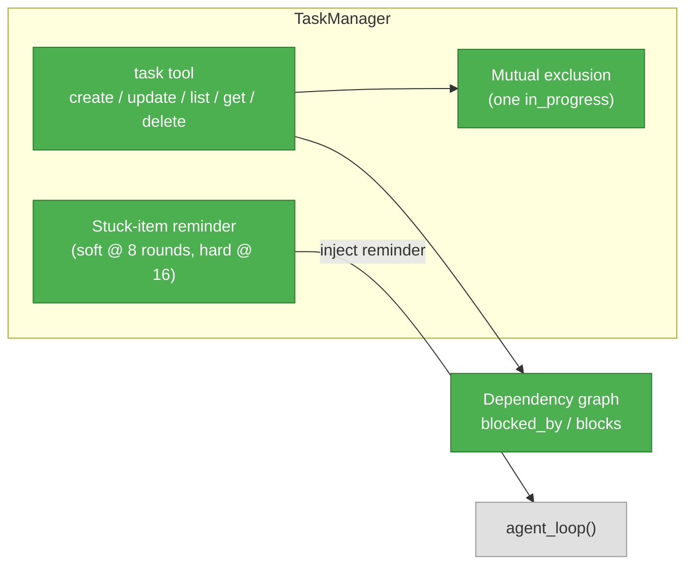

### Phase 7: Subagent (10 tools)

Delegate *thinking*: spawn a child agent with a fresh message list and a restricted tool set. The child runs synchronously on the main thread; the parent gets back only the child's text summary. Trades wall-clock time for parent-context tokens.

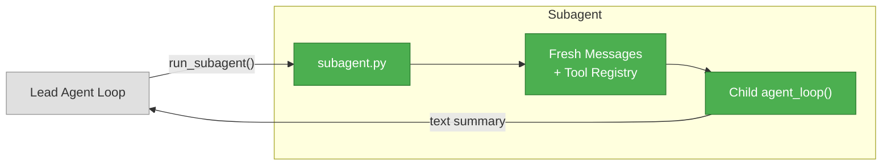

### Phase 8: Background (12 tools)

Delegate *thinking without blocking*: run a subagent (the Phase-7 child loop) on a daemon thread. The agent loop drains a thread-safe mailbox at the top of each iteration, so the child's summary lands in the conversation when the model is ready for it. The child runs with `quiet=True` so its streamed tokens stay off the terminal — a single loop flag, not per-thread stdout routing.

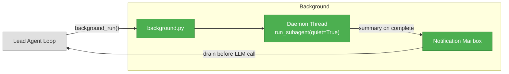

### Phase 9: Teams (13 tools)

Named teammates that remember across tasks, coordinated by the lead hub-and-spoke. The lead `hire`s a teammate (a name + a role), `assign`s it a task that runs in the background on its own thread, and `wait`s to gather every teammate's report. Unlike a one-shot subagent, a teammate keeps its own message history *across assignments* — so it remembers earlier work and you can keep handing it follow-ups. Teammates never talk to each other; they report only to the lead. Each teammate's loop runs with `quiet=True`, so parallel work doesn't garble the lead's terminal — `wait` prints each `[name] ✓ …` report on the main thread as it lands. One `team` tool covers hire / assign / wait / status.

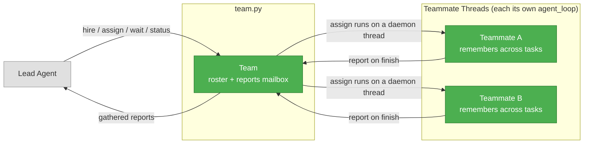

### Phase 10: Autonomous (13 tools)

The same team, made autonomous by flipping *push* to *pull*. In Phase 9 the lead hand-assigns each task to a named teammate and waits at an all-or-nothing barrier — so a free teammate can't grab the next task while another is busy. Phase 10 instead hands the team a *list* of tasks via the `team` tool's `run` action. The tasks go into a shared queue, and every teammate runs a pull-loop: grab the next free task, do it, grab the next — until the queue is empty. The team self-distributes and self-balances (a faster teammate naturally does more), and the run stops on an *objective* condition: the queue is empty. No new tool — `assign`/`wait` are replaced by `run`.

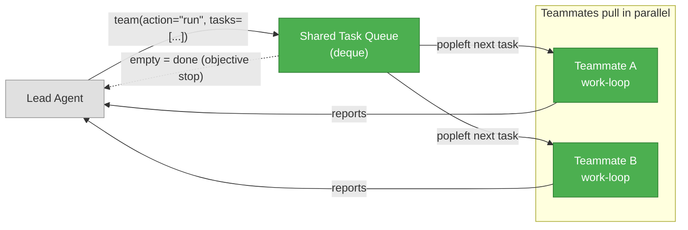

### Phase 11: Workspace Isolation (14 tools)

Filesystem isolation — distinct from the *context* isolation a subagent already has (its own message history). The agent can create a git *worktree*: a separate working folder on its own branch, backed by the same repo, to try an experiment or an alternative implementation without touching the main workspace. Two worktrees are two independent directories — a file written in one can't touch the other. One `worktree` tool wraps the basic git commands: `create` (`git worktree add worktrees/<name> -b <name>`) and `list` (`git worktree list`). It never runs `git init` — isolation assumes an existing repo with a base commit, and returns a friendly error otherwise.

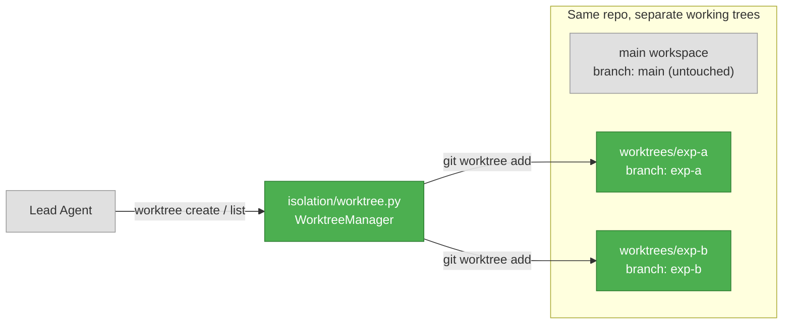

---

## Tool Reference

All 14 tools organized by phase of introduction.

| # | Tool | Phase | Module | Description |
|---|------|-------|--------|-------------|
| 1 | `bash` | 2 | `tools/bash.py` | Execute shell commands with safety blocking |
| 2 | `read_file` | 3 | `tools/files.py` | Read file contents with optional line range |
| 3 | `write_file` | 3 | `tools/files.py` | Create or overwrite files |
| 4 | `edit_file` | 3 | `tools/files.py` | Find-and-replace within files |
| 5 | `list_files` | 3 | `tools/files.py` | Glob pattern file listing |
| 6 | `search_files` | 3 | `tools/files.py` | Regex search across files |
| 7 | `compact` | 4 | `memory/compression.py` | Manually compress conversation context |
| 8 | `load_skill` | 5 | `knowledge/skills.py` | Load full skill body on demand |
| 9 | `task` | 6 | `planning/tasks.py` | Create / update / list / get / delete tasks (action-dispatched) with mutual-exclusion `in_progress`, dependency graph, and stuck-item nag |
| 10 | `subagent` | 7 | `parallel/subagent.py` | Spawn child agent with isolated context |
| 11 | `background_run` | 8 | `parallel/background.py` | Run a subagent in a background daemon thread |
| 12 | `check_background` | 8 | `parallel/background.py` | Check status of background tasks |
| 13 | `team` | 9 | `parallel/team.py` | Build and run a team of named, memory-keeping teammates. Phase 9 (push): `hire` / `assign` / `wait` / `status`. Phase 10 (pull): `assign`/`wait` are replaced by `run`, which loads a shared task queue the teammates pull from until empty |
| 14 | `worktree` | 11 | `isolation/worktree.py` | Create and list git worktrees — isolated working folders, each on its own branch (`create` / `list`) |
